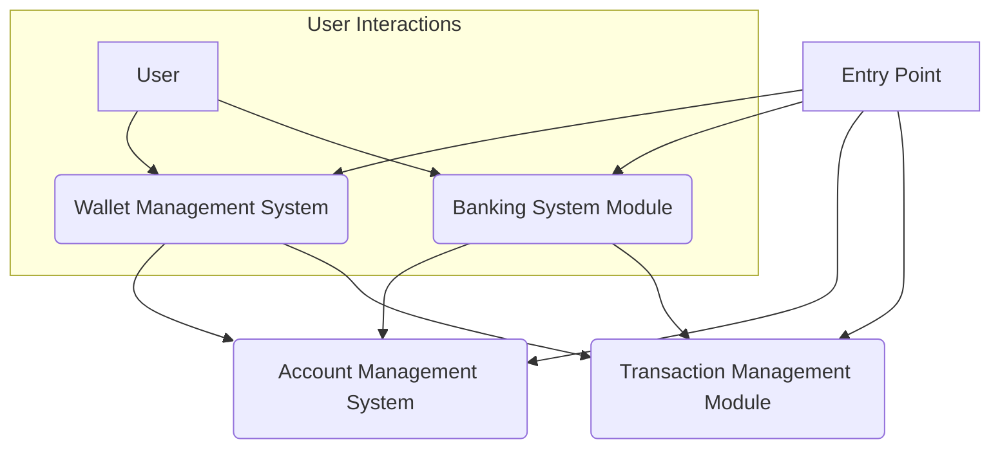

# System Architecture Overview: Digital Banking & Wallet Platform

## 1. System Purpose

The primary purpose of this system is to provide a robust, secure, and modular platform for managing user financial accounts and facilitating various financial transactions. It aims to offer functionalities typically found in both traditional banking systems and modern digital wallet applications, enabling users to manage their funds, perform deposits and withdrawals, and monitor their account balances effectively.

## 2. High-Level Architecture

The system is designed with a clear separation of concerns, organized into distinct, high-level modules that interact to deliver comprehensive financial services. This modular approach promotes maintainability, scalability, and independent development of core functionalities. At its heart, the architecture revolves around managing account states and recording all financial operations, exposed through different user-facing or business-logic-oriented services.

## 3. Core Functional Components

The system is composed of the following key functional modules:

### 3.1. Entry Point (Module 1)
*   **Description**: This module serves as the initial starting point for the entire application. It is responsible for bootstrapping the application environment, initializing necessary services, and launching the main execution flow.
*   **Role**: The gateway for application startup and overall system orchestration.

### 3.2. Account Management System (Module 5)
*   **Description**: This foundational module is dedicated to the persistent storage and management of user account data. It handles the creation, retrieval, and updates of account-specific information, including unique identifiers, owner details, and current balance values.
*   **Role**: The authoritative source for all account-related data and state.

### 3.3. Transaction Management Module (Module 6)
*   **Description**: This module is responsible for the lifecycle of all financial transactions within the system. It enables the creation, tracking, and manipulation of transaction objects, capturing essential details such as transaction ID, associated account ID, amount, type (e.g., deposit, withdrawal), and timestamp.
*   **Role**: Ensures the integrity and traceability of all financial operations.

### 3.4. Wallet Management System (Module 7)
*   **Description**: This module provides user-facing functionalities specifically tailored for digital wallet operations. It allows users to perform common wallet actions such as depositing funds, withdrawing funds, and checking their current wallet balance.
*   **Role**: Exposes digital wallet capabilities to end-users, leveraging underlying account and transaction services.

### 3.5. Banking System Module (Module 4)
*   **Description**: This module encapsulates broader banking functionalities, offering a more comprehensive set of services beyond just wallet operations. It manages user transactions, including deposits, withdrawals, and checking account balances, potentially handling different types of accounts or more complex banking logic.
*   **Role**: Provides core banking services, potentially integrating or extending wallet functionalities.

## 4. Component Relationships & Interactions

The modules are designed to interact in a cohesive manner, forming a complete financial ecosystem:

*   **Initialization Flow**: The **Entry Point (Module 1)** is the first to execute, responsible for initializing and configuring all other core services (Account Management, Transaction Management, Wallet Management, Banking System).
*   **Foundational Services**: The **Account Management System (Module 5)** and **Transaction Management Module (Module 6)** act as foundational services. They do not directly expose user-facing features but provide critical data and operational capabilities to higher-level modules.
*   **Service Consumption**:
    *   Both the **Wallet Management System (Module 7)** and the **Banking System Module (Module 4)** heavily rely on the **Account Management System (Module 5)** to retrieve and update account balances and owner information.
    *   Similarly, both the **Wallet Management System (Module 7)** and the **Banking System Module (Module 4)** utilize the **Transaction Management Module (Module 6)** to record every financial operation (deposits, withdrawals) performed through their respective interfaces.
*   **Feature Overlap/Integration**: The **Wallet Management System (Module 7)** and the **Banking System Module (Module 4)** represent distinct but potentially overlapping sets of features. It is plausible that the Banking System Module might encompass or integrate the Wallet Management System as one of its offerings, or they could operate as parallel services on the same underlying account and transaction data, catering to different user experiences or business requirements.

**Conceptual Interaction Flow:**

## 5. Supporting Infrastructure & Quality Assurance

### 5.1. Unit Testing Library (Module 0)
*   **Description**: This module represents the framework and utilities dedicated to unit testing the application's components. It ensures the correct initialization and loading of the Spring Boot application context during tests, validating the behavior of individual units of code.
*   **Role**: Essential for maintaining code quality, ensuring correctness, and facilitating robust development by verifying component functionality in isolation.

## 6. Conclusion

This architecture outlines a clear, modular approach to building a comprehensive digital banking and wallet platform. By separating concerns into distinct modules for account management, transaction processing, and various user-facing financial services, the system achieves high cohesion within modules and loose coupling between them. This design fosters a scalable, maintainable, and robust foundation for future enhancements and expansions.